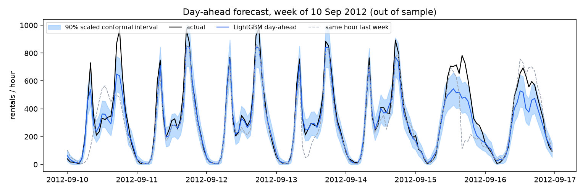
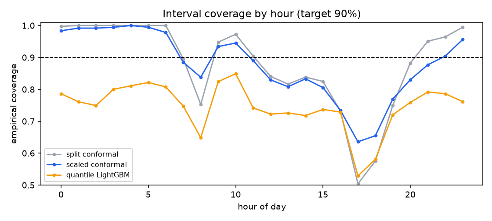
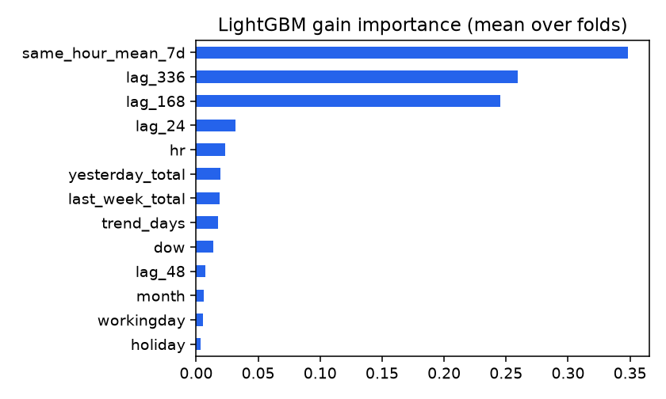

# Day-ahead demand forecasting, backtested honestly

Forecast hourly bike-rental demand for tomorrow, at midnight, on the public [UCI Bike Sharing](https://archive.ics.uci.edu/dataset/275/bike+sharing+dataset) dataset (Washington D.C., 2011–2012, 17,544 hours). The point of the project is the evaluation, more than the model: how to tell whether a forecasting model is actually better than "same as last week", and whether its uncertainty intervals mean what they say.

## The rules this repo enforces

- **No look-ahead.** A day-ahead forecast issued at 00:00 can only use information known at 00:00, so the shortest lag is 24 h. A unit test enforces this: it changes every count on one day and asserts that none of that day's features move.
- **No pretending weather is known.** Actual observed weather is *not* known a day ahead. It appears only in an explicitly labelled **oracle** model, which bounds what a perfect weather forecast would be worth.
- **Rolling-origin backtest.** Twelve monthly folds over 2012 with an expanding training window. Each fold retrains on everything before the month and forecasts the month day by day.
- **Model choices made on a dev period.** Candidates were compared on six 2011 folds (Jul–Dec). The winner was fixed *before* the final run on 2012.
- **Baselines that are hard to beat.** "Same hour last week" (seasonal naive) is the yardstick, and MASE is reported against it.

## Results: 2012, 8,734 out-of-sample hours

| Model | MAE | RMSE | WAPE | MASE vs last-week naive | months beating naive |
|---|---|---|---|---|---|
| Same hour yesterday | 76.8 | 128.5 | 0.327 | 1.256 | 2 / 12 |
| **Same hour last week** (baseline) | 61.1 | 105.3 | 0.261 | 1.000 | — |
| LightGBM, predicting counts (Poisson) | 63.3 | 102.7 | 0.270 | 1.035 | 7 / 12 |
| LightGBM, predicting demand relative to last week's level | 56.4 | 92.0 | 0.240 | 0.923 | 9 / 12 |
| **Average of the two LightGBMs (chosen on dev)** | **54.3** | **86.9** | **0.231** | **0.888** | **9 / 12** |
| *Oracle: LightGBM + the weather that actually happened* | *43.3* | *70.9* | *0.185* | *0.709* | *12 / 12* |



### What happened, in order

1. **The first model lost to the naive baseline.** LightGBM predicting raw counts reached WAPE 0.270 against the baseline's 0.261, and fell apart in April (0.445) and June (0.336). Total demand grew 65% from 2011 to 2012. Trees cannot extrapolate beyond the target values they were trained on, so a model trained on mostly 2011 levels under-forecast the 2012 spring.
2. **I proposed a fix and tested it on dev, not on 2012.** The fix predicts `log((y+1)/(level+1))`, where `level` is last week's mean hourly demand, so the trees learn the *shape* of a day and the level carries the growth. On the 2011 dev folds this variant was actually *worse* than the original (0.269 vs 0.252), but averaging the two was best (0.243). I fixed the average as the final model.
3. **On 2012 the pre-chosen average beat the baseline by 11.2% WAPE** and won 9 of 12 months. The level-relative model alone did almost as well there, which dev did not predict. That's the honest cost of selecting on a period with different dynamics.
4. **The disclosure that matters:** I saw the first model's 2012 numbers before designing the alternatives, so 2012 is not perfectly untouched. The *choice between* candidates was made on dev only.

**Weather is the biggest lever.** The oracle cuts WAPE from 0.231 to 0.185 and wins every month. The gap between those two rows is the most a real day-ahead weather feed could add, and it's the next thing I'd build.

## Prediction intervals (target 90%)

| Method | Coverage | Mean width | Night 00–05 | Commute peaks | Other daytime | Worst month |
|---|---|---|---|---|---|---|
| Split conformal | 0.881 | 267 | 1.000 | 0.737 | 0.908 | 0.789 |
| Scaled conformal (residual / √ŷ) | 0.877 | 231 | 0.993 | 0.779 | 0.878 | 0.753 |
| LightGBM quantile regression 5–95% | 0.746 | 158 | 0.788 | 0.683 | 0.764 | 0.667 |



- **Quantile regression is badly over-confident:** 75% coverage for a nominal 90%. Don't ship uncalibrated quantiles.
- **Conformal intervals come close (88%), but not to 90%.** Conformal guarantees coverage only if calibration and test data are exchangeable, and a growing series breaks that: the calibration month is always from a lower-demand regime than the month being forecast. On the stabler 2011 dev period, coverage was 0.909.
- **Marginal coverage hides the hours that matter.** Plain intervals are too wide at night (100% coverage) and too narrow at the commute peaks (74%). Scaling by √ŷ moves width toward the peaks (74% → 78%) and makes intervals 13% narrower on average. A per-hour calibration set would be the next step.

## Feature importance



## Run it

```bash
uv venv && uv pip install -e '.[dev]'
mkdir -p data && curl -sSfL -o data/bike.zip https://archive.ics.uci.edu/static/public/275/bike+sharing+dataset.zip && (cd data && unzip -o bike.zip)
python -m dfb.backtest --folds dev  --out results/dev   # model selection (2011)
python -m dfb.backtest --folds test --out results       # final (2012), ~6 min
pytest
```

## Code

```
src/dfb/
  data.py        complete hourly grid (165 missing source hours = outages; excluded from scoring)
  features.py    lags ≥ 24 h only, weather only on request, level-relative transforms
  backtest.py    rolling-origin folds, model wrapper hiding the target transform, report + plots
  conformal.py   split conformal (exact finite-sample rank) and √ŷ-scaled variant
  metrics.py     MAE, RMSE, WAPE (zero-safe), coverage
```

While writing tests I found and fixed an off-by-one in the conformal quantile. It took the (k+1)-th residual instead of the k-th, making intervals very slightly too wide. All numbers above come from the corrected code.

## Limitations

- One city, two years. With only one full prior year, the model has seen each month of the calendar once.
- Intervals are computed around the count-level LightGBM, not the final average.
- No hierarchy, promotions or events: this is a single aggregate series, with none of the SKU-store hierarchy retail forecasting deals with.
