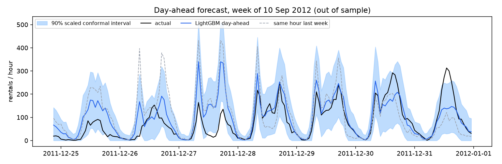
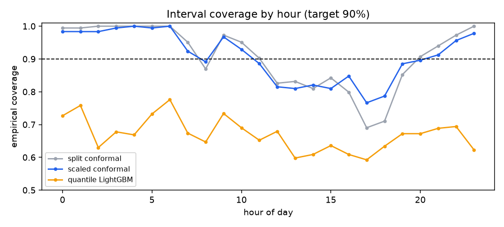
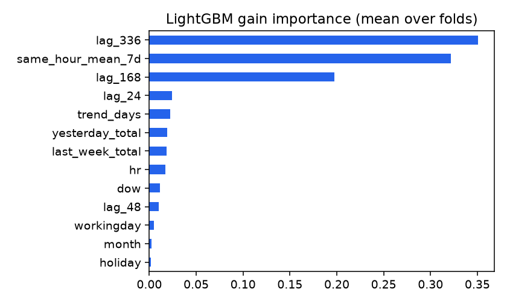

# Backtest results

4395 out-of-sample hours (monthly folds, expanding window; target transform: level; folds: dev). Outage hours excluded from scoring.

## Point forecasts

| Model | MAE | RMSE | WAPE | MASE vs last-week naive | folds beating naive (of 12) |
|---|---|---|---|---|---|
| naive_24 | 57.7 | 94.2 | 0.353 | 1.133 | 2 |
| naive_168 | 50.9 | 86.5 | 0.312 | 1.000 | 0 |
| mean_7d | 58.4 | 84.9 | 0.357 | 1.147 | 1 |
| lgbm | 41.2 | 66.1 | 0.252 | 0.810 | 6 |
| lgbm_relative | 44.0 | 70.1 | 0.269 | 0.863 | 5 |
| ens_level_relative | 39.8 | 63.5 | 0.243 | 0.781 | 6 |
| ens_lgbm_naive168 | 42.2 | 70.9 | 0.258 | 0.829 | 6 |
| lgbm_oracle_weather | 33.7 | 52.8 | 0.206 | 0.661 | 6 |

`lgbm_oracle_weather` uses the weather that actually happened, which is not known a day ahead. It is an upper bound on the value of a perfect weather forecast, not a deployable model.

## 90% prediction intervals

| Method | Coverage | Mean width | Night | Commute peaks | Other daytime | Worst month |
|---|---|---|---|---|---|---|
| split conformal | 0.909 | 207 | 0.998 | 0.835 | 0.907 | 0.825 |
| scaled conformal | 0.909 | 176 | 0.990 | 0.867 | 0.892 | 0.823 |
| LightGBM quantile 5-95% | 0.670 | 96 | 0.699 | 0.652 | 0.665 | 0.554 |

## WAPE per fold

| Month | last-week naive | 7-day same-hour mean | LightGBM | LightGBM + oracle weather |
|---|---|---|---|---|
| 2011-07 | 0.245 | 0.316 | 0.238 | 0.208 |
| 2011-08 | 0.208 | 0.298 | 0.172 | 0.152 |
| 2011-09 | 0.390 | 0.374 | 0.279 | 0.242 |
| 2011-10 | 0.336 | 0.380 | 0.298 | 0.188 |
| 2011-11 | 0.321 | 0.384 | 0.245 | 0.200 |
| 2011-12 | 0.421 | 0.430 | 0.306 | 0.268 |

