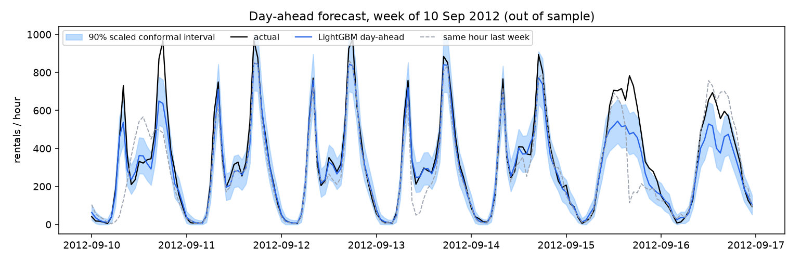
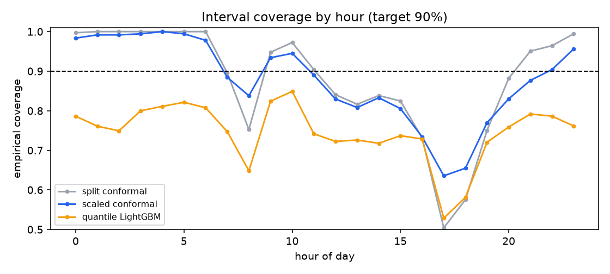
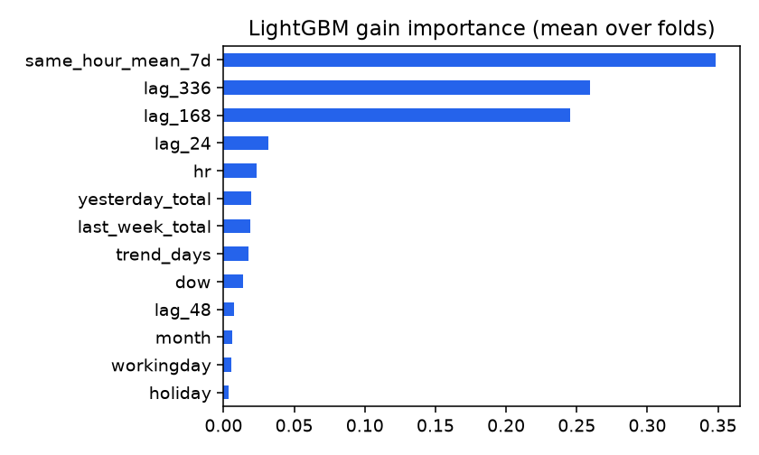

# Backtest results

8734 out-of-sample hours (monthly folds, expanding window; target transform: level; folds: test). Outage hours excluded from scoring.

## Point forecasts

| Model | MAE | RMSE | WAPE | MASE vs last-week naive | folds beating naive (of 12) |
|---|---|---|---|---|---|
| naive_24 | 76.8 | 128.5 | 0.327 | 1.256 | 2 |
| naive_168 | 61.1 | 105.3 | 0.261 | 1.000 | 0 |
| mean_7d | 78.1 | 114.6 | 0.333 | 1.278 | 1 |
| lgbm | 63.3 | 102.7 | 0.270 | 1.035 | 7 |
| lgbm_relative | 56.4 | 92.0 | 0.240 | 0.923 | 9 |
| ens_level_relative | 54.3 | 86.9 | 0.231 | 0.888 | 9 |
| ens_lgbm_naive168 | 55.3 | 90.7 | 0.236 | 0.905 | 10 |
| lgbm_oracle_weather | 43.3 | 70.9 | 0.185 | 0.709 | 12 |

`lgbm_oracle_weather` uses the weather that actually happened, which is not known a day ahead. It is an upper bound on the value of a perfect weather forecast, not a deployable model.

## 90% prediction intervals

| Method | Coverage | Mean width | Night | Commute peaks | Other daytime | Worst month |
|---|---|---|---|---|---|---|
| split conformal | 0.881 | 267 | 1.000 | 0.737 | 0.908 | 0.789 |
| scaled conformal | 0.877 | 231 | 0.993 | 0.779 | 0.878 | 0.753 |
| LightGBM quantile 5-95% | 0.746 | 158 | 0.788 | 0.683 | 0.764 | 0.667 |

## WAPE per fold

| Month | last-week naive | 7-day same-hour mean | LightGBM | LightGBM + oracle weather |
|---|---|---|---|---|
| 2012-01 | 0.394 | 0.425 | 0.329 | 0.252 |
| 2012-02 | 0.310 | 0.384 | 0.308 | 0.236 |
| 2012-03 | 0.294 | 0.320 | 0.274 | 0.229 |
| 2012-04 | 0.285 | 0.339 | 0.445 | 0.226 |
| 2012-05 | 0.216 | 0.323 | 0.217 | 0.167 |
| 2012-06 | 0.207 | 0.302 | 0.336 | 0.139 |
| 2012-07 | 0.235 | 0.303 | 0.290 | 0.196 |
| 2012-08 | 0.146 | 0.268 | 0.161 | 0.131 |
| 2012-09 | 0.203 | 0.331 | 0.174 | 0.134 |
| 2012-10 | 0.239 | 0.337 | 0.217 | 0.170 |
| 2012-11 | 0.405 | 0.368 | 0.262 | 0.197 |
| 2012-12 | 0.392 | 0.408 | 0.329 | 0.248 |

